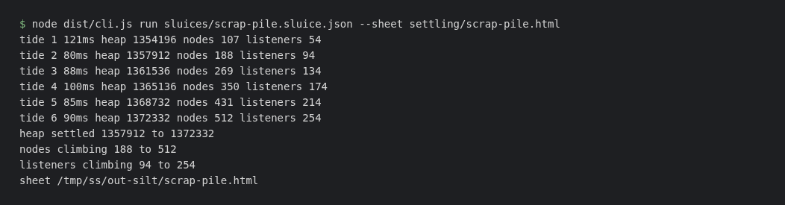
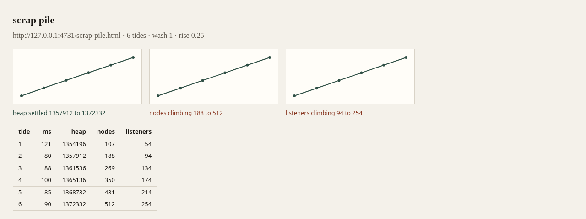

# silttrap

I wrote a small command line tool that opens one Chromium, replays one browser flow over and over in that same session, and exits with a failure if the memory numbers keep rising. It also writes a single HTML file you can open in a browser.

This is a real run of the scrap pile sluice from the demo below. Nodes and listeners climb, so it exits 1. The second picture is the sheet it wrote.





## words

A **sluice** is the JSON file that describes the flow. The **bed** is the URL a tide starts at. A **gate** is one step in that flow. A **tide** is one full replay. A **silt reading** is the three numbers taken after a tide: JS heap used, DOM node count, and event listener count. I take them over the Chrome DevTools protocol after forcing garbage collection twice, so the reading is what is still retained.

**Wash** is how many leading tides I ignore. The first one is warm-up. **Rise** is the fraction the last counted reading may sit above the first. Under that, the metric is **settled**. Over it, the metric is **climbing**. Fewer than two counted readings is **short**. I compare the two ends only. A spike in the middle does not count.

The HTML file is a **sheet**.

## run

You need Node 20 or newer.

```
npm install
npx playwright install chromium
npm run build
```

A sluice looks like this:

```json
{
  "title": "swept pan",
  "bed": "http://127.0.0.1:4731/swept-pan.html",
  "tideCount": 6,
  "wash": 1,
  "rise": 0.25,
  "gates": [
    { "kind": "nudge", "mark": "button.again" },
    { "kind": "hold", "ms": 30 }
  ]
}
```

- `title` is a non-empty string.
- `bed` is an `http` or `https` URL.
- `tideCount` is an integer greater than zero. `--tides N` overrides it for one run.
- `wash` is optional, an integer of zero or more. Default 1.
- `rise` is optional, a number of zero or more. Default 0.1.
- `gates` is an ordered list. It may be empty.

Gate kinds:

- `course` opens `path`, an `http` or `https` URL, or a path that starts with `/`.
- `nudge` clicks whatever `mark` matches.
- `pour` types `text` into whatever `mark` matches. `text` may be empty.
- `hold` waits `ms` milliseconds, a positive integer.

Any other field is rejected.

```
node dist/cli.js run sluices/swept-pan.sluice.json
```

Each tide prints one line, then one line per metric. One run looked like this. The bytes will not match yours:

```
tide 1 108ms heap 1357080 nodes 26 listeners 14
heap settled 1357392 to 1357420
nodes settled 26 to 26
listeners settled 14 to 14
sheet settling/sheet.html
```

The process exits 0 when every metric is settled. It exits 1 when any metric is climbing or short. `--wash` and `--rise` override the sluice. `--sheet PATH` chooses the HTML file. The default path is `settling/sheet.html`, and that folder is gitignored.

A path that starts with `/` is not joined onto the bed. `sluices/note-desk.sluice.json` still has one, so that file does not finish a tide.

## sheet

The sheet is one HTML file. The CSS is inline. There are three small SVG line charts, one each for heap, nodes, and listeners, each on its own scale. Under each chart is the verdict for that metric, including the from and to numbers when I had two readings to compare. The page also shows the sluice title, the bed, how many tides ran, the wash and rise I used, and a table of the raw readings. Nothing is loaded from the network. Text that came from the sluice is escaped.

I write the sheet even when the run is climbing. Open the file in a browser. A climbing caption is the metric that failed. The table is the same numbers the charts are drawn from.

## demo

`demo/scrap-pile.html` and `demo/swept-pan.html` are the same small page. A click builds a batch of detached nodes, with a listener on each node, and holds them in an array. The pile keeps every batch. The pan builds the same batches and then drops them, listeners included. Each tide loads the page again, so the pile remembers the visit count in `sessionStorage` and keeps that many batches in the new document. That is the leak the reading can see.

The pages are served by a tiny Node server, with no dependencies, on port 4731:

```
npm run beds
```

In another shell:

```
node dist/cli.js run sluices/swept-pan.sluice.json --sheet settling/swept-pan.html
node dist/cli.js run sluices/scrap-pile.sluice.json --sheet settling/scrap-pile.html
```

The pan should exit 0. The pile should exit 1, with nodes and listeners climbing. Both sluices use wash 1 and rise 0.25, so a little noise does not fail the pan, and a pile that more than doubles still fails.

GitHub Actions runs those two commands on every push, and when I start the workflow by hand. The pile is expected to exit non-zero. The sheets are uploaded as artifacts.

## limits

This is Chromium only. The three numbers are Chrome DevTools fields. I do not launch Firefox or WebKit.

Two forced collections are not a perfect floor. A quiet run can still move the heap by a little, and a small retained object can disappear next to the baseline heap. On the scrap pile the heap stays inside the rise while the node count and the listener count climb. That is why the verdict is per metric.

I judge the last counted reading against the first one. I do not look at the shape in between.

A tide always starts with a fresh load of the bed. If the page drops everything at the end of the click, the next tide will not show a leak.

A `course` path that starts with `/` is not joined onto the bed yet. Reaching one throws.

A short series is not a pass. I will not call it settled.
